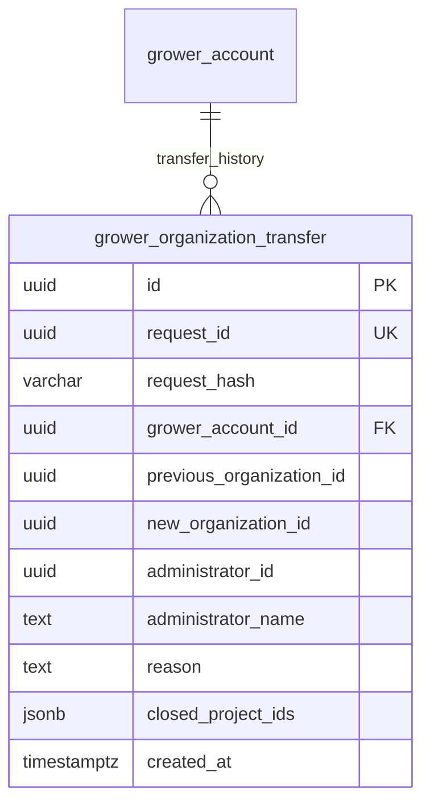

# NDM grower organization transfer history

Added through the Admin Panel integration. Migration `20261122110000-grower-organization-transfer-audit` records platform-admin transfers of a grower's current primary organization.

The Admin API locks the grower, verifies the exact profile version and platform role, updates current NDM organization links and closes active project memberships in the previous primary organization. It writes authenticated actor UUID/name, mandatory reason and affected project UUIDs atomically. The Stakeholder `project_grower_event` table also receives one removal event per closed project. Historical sessions/captures/contracts/payments and staff Keycloak/Stripe identities are unchanged. This is not a historical ownership migration.

Organization UUIDs refer to Stakeholder; actor UUIDs refer to Keycloak. No cross-service foreign keys are added. API request replay is idempotent. Applied in verified dev only, with rollback rehearsal and disposable synthetic tests for conflicts, membership move and audit attribution. Down migration drops audit history.
