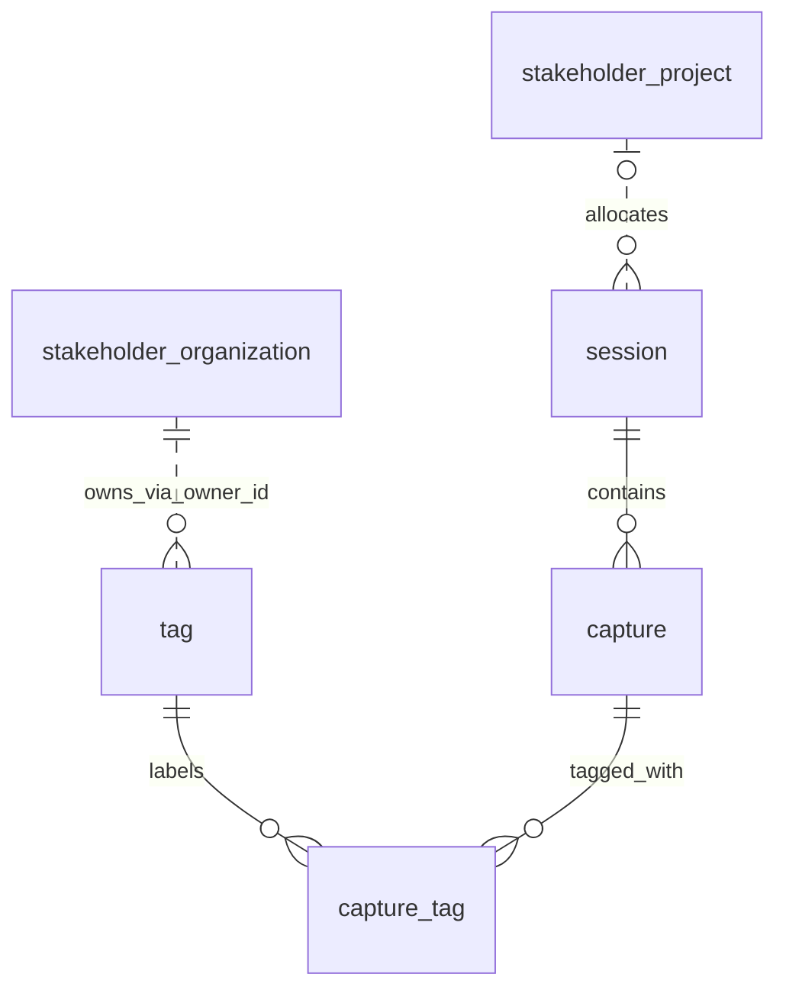

# Organization-scoped capture tags

Added through the Admin Panel NDM integration. The existing model already separates the dictionary (`treetracker.tag`) from capture associations (`treetracker.capture_tag`). `tag.owner_id` stores the owning Stakeholder organization UUID as text. No duplicate organization field is needed on every capture-tag link, and this migration does not guess or rewrite historical ownership.

The scoped Admin API dictionary requires an approved organization, including for platform callers. It returns active tags owned by that organization. For legacy unowned public tags, only names proven to have been used on active NDM captures owned by that organization may appear. Unused global tags and tags owned by a different organization are excluded. On reuse, the writer creates/reuses a private organization-owned tag; it never attaches another organization's public/private tag as a shortcut. Search and reuse are case-insensitive.

Optional project scope narrows suggestions to actual tag usage on captures in sessions currently allocated to that project. Project ownership is checked against the organization. Tags remain organization-owned so they can be reused across projects. Admin session corrections change which project's usage list includes a session's tags.

Migration `20261122140000-scoped-capture-tag-lookups` adds partial active-row indexes on `(owner_id,lower(name))` and capture-tag `(tag_id,capture_id)`. Indexes improve lookups; API authorization enforces visibility. No new columns or public-schema writes. Down migration removes only these indexes. Apply/rollback savepoint rehearsal completed in dev.

The admin verifier now resolves tags once per organization and bulk-inserts capture/tag/event/audit records. A dev test of 25 captures and two tags decreased from 258 transaction statements / 74.49 seconds to 13 statements / 4.12 seconds. These are remote dev measurements, not a production latency guarantee. Stale-batch rollback, exact timestamps, idempotent replay and reviewer attribution remain enforced.

Legacy admin `/tags` uses `public.tag` and is not an organization dictionary. NDM Verify uses `/api/admin-domain/capture-tags`; other legacy consumers must be migrated before claiming organization isolation for those legacy screens. No ownership can safely be inferred for unused, unowned historical names.

Related: Greenstand/treetracker-admin-api#699 and Greenstand/treetracker-admin-client#1315.
